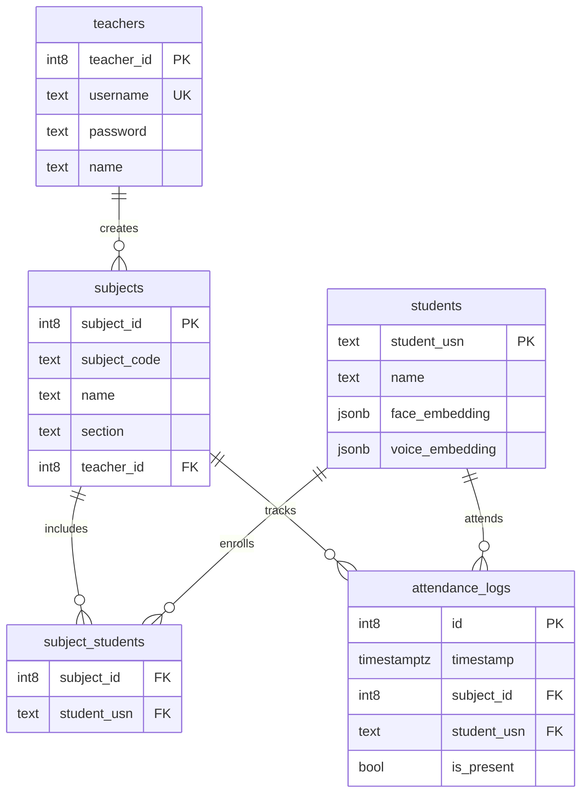

# SnapClass (Drishti_AI) 🎓🤖
> **Making Attendance Faster & Smarter Using Multimodal AI**

SnapClass (PresenAI) is an intelligent, multimodal attendance management system powered by **Face Recognition** and **Voice Biometrics**. Designed for modern classrooms, it automates attendance logging through multi-face photo scanning and classroom audio analysis, eliminating manual roll calls.

---

## 🌟 Key Features

### 👨‍🏫 Teacher Portal
* **Secure Authentication**: Password-protected login and registration with salted `bcrypt` hashing.
* **Course Management**:
  * Create subjects with subject code, name, and section.
  * Real-time subject metrics (enrolled students count, total classes conducted).
  * Generate shareable class links and QR codes (powered by `segno`) for instant student enrollment.
* **Multimodal Attendance Logging**:
  * **AI Face Attendance**: Upload or snap multi-student classroom photos; deep-scans all faces simultaneously using `dlib` ResNet embeddings and SVM classification.
  * **AI Voice Attendance**: Record classroom audio of students saying "I am present"; detects and matches speaker voice embeddings using `Resemblyzer` and `librosa`.
  * **Review & Confirm**: Interactive preview table showing detected students, matching sources, and presence status before committing to the database.
* **Attendance Analytics**: Historical records grouped by timestamp and subject, showing attendance rates and student counts.

### 👨‍🎓 Student Portal
* **FaceID Login**: Frictionless authentication by snapping a selfie with your webcam.
* **Student Onboarding**: Simple profile registration with Face photo embedding and optional voice signature enrollment.
* **Student Dashboard**:
  * View all enrolled subjects with individual attendance statistics (Classes Attended vs. Total Classes).
  * One-click course enrollment via subject code.
  * Deep-link / QR code auto-enrollment via `?join-code=<SUBJECT_CODE>`.
  * Self-service unenrollment.

---

## 🏗️ Architecture & Tech Stack

* **Frontend & Web UI**: [Streamlit](https://streamlit.io/) with customized CSS design (Google Fonts *Outfit* & *Climate Crisis*).
* **Database & Storage**: [Supabase](https://supabase.com/) (PostgreSQL) with Row-Level Security (RLS).
* **Computer Vision / Face Pipeline**:
  * `dlib` frontal face detector
  * `dlib` 68-point shape predictor (`shape_predictor_68_face_landmarks.dat`)
  * `dlib` ResNet-based 128-dimensional face recognition model (`dlib_face_recognition_resnet_model_v1.dat`)
  * `scikit-learn` Support Vector Classifier (SVC) for student identification
* **Audio / Voice Pipeline**:
  * `Resemblyzer` for deep voice embeddings (VoiceEncoder)
  * `librosa` for audio loading, normalization, and silence splitting
* **QR Codes & Security**: `segno` for QR code synthesis, `bcrypt` for password hashing.

---

## 🗄️ Database Schema (Supabase)

The project relies on 5 relational tables in PostgreSQL:



---

## 🚀 Getting Started

### 1. Prerequisites
* **Python**: 3.10 to 3.13 recommended.
* **C++ Build Tools & CMake**: Required for compiling `dlib` if wheels are not cached.
* **Pretrained Models**: Download and place the following pretrained model files in `C:\models\` (or update the path in `src/pipelines/face_pipeline.py`):
  * `shape_predictor_68_face_landmarks.dat`
  * `dlib_face_recognition_resnet_model_v1.dat`

### 2. Clone Repository & Setup Virtual Environment
```bash
git clone <YOUR_REPOSITORY_URL>
cd PresenAI

# Create virtual environment
python -m venv venv

# Activate virtual environment
# Windows (PowerShell):
.\venv\Scripts\Activate.ps1
# macOS/Linux:
source venv/bin/activate
```

### 3. Install Dependencies
```bash
pip install -r requirements.txt
```

### 4. Configure Supabase Credentials
Create `.streamlit/secrets.toml` in the project root:
```toml
SUPABASE_URL = "https://your-project-id.supabase.co"
SUPABASE_KEY = "your-anon-or-service-role-key"
```

### 5. Setup Supabase Row-Level Security (RLS)
Run this SQL script in your **Supabase Dashboard -> SQL Editor** to allow the application to query and write records:
```sql
-- Allow public access for application tables
CREATE POLICY "Allow public all on teachers" ON public.teachers FOR ALL TO anon, authenticated USING (true) WITH CHECK (true);
CREATE POLICY "Allow public all on students" ON public.students FOR ALL TO anon, authenticated USING (true) WITH CHECK (true);
CREATE POLICY "Allow public all on subjects" ON public.subjects FOR ALL TO anon, authenticated USING (true) WITH CHECK (true);
CREATE POLICY "Allow public all on subject_students" ON public.subject_students FOR ALL TO anon, authenticated USING (true) WITH CHECK (true);
CREATE POLICY "Allow public all on attendance_logs" ON public.attendance_logs FOR ALL TO anon, authenticated USING (true) WITH CHECK (true);
```

---

## 💻 Running the Application

Launch the Streamlit dashboard:
```bash
streamlit run app.py
```

Once running, access the application in your browser:
* **Local URL**: `http://localhost:8501`

---

## 📂 Project Structure

```text
PresenAI/
├── .streamlit/
│   ├── config.toml                # Streamlit UI & theme configurations
│   └── secrets.toml               # Supabase credentials (git-ignored)
├── src/
│   ├── components/                # Reusable UI widgets & modal dialogs
│   │   ├── dialog_add_photo.py    # Camera & upload dialog for classroom photos
│   │   ├── dialog_attendance_results.py  # Results preview & confirm modal
│   │   ├── dialog_auto_enroll.py  # URL join-code auto-enrollment modal
│   │   ├── dialog_create_subject.py      # New subject creation modal
│   │   ├── dialog_enroll.py       # Subject code manual enrollment modal
│   │   ├── dialog_share_subject.py# QR code & class link generator modal
│   │   ├── dialog_voice_attendance.py    # Voice recording & recognition modal
│   │   ├── footer.py              # Application footer
│   │   ├── header.py              # Navigation header
│   │   └── subject_card.py        # Course information card component
│   ├── database/
│   │   ├── config.py              # Supabase client initialization
│   │   └── db.py                  # Database CRUD queries and operations
│   ├── pipelines/
│   │   ├── face_pipeline.py       # dlib feature extractor & SVM classifier
│   │   └── voice_pipeline.py      # Resemblyzer voice embedding & speaker match
│   ├── screens/
│   │   ├── home_screen.py         # Landing & portal selection view
│   │   ├── student_screen.py      # Student portal (FaceID login & dashboard)
│   │   └── teacher_screen.py      # Teacher portal (auth, subjects, attendance)
│   └── ui/
│       └── base_layout.py         # Custom CSS styling, typography, and buttons
├── app.py                         # Application entrypoint and router
├── requirements.txt               # Python package dependencies
└── README.md                      # Project documentation
```

---

## 🛡️ License & Acknowledgments
Built with ❤️ for educational automation. Powered by Streamlit, Supabase, dlib, and Resemblyzer.
